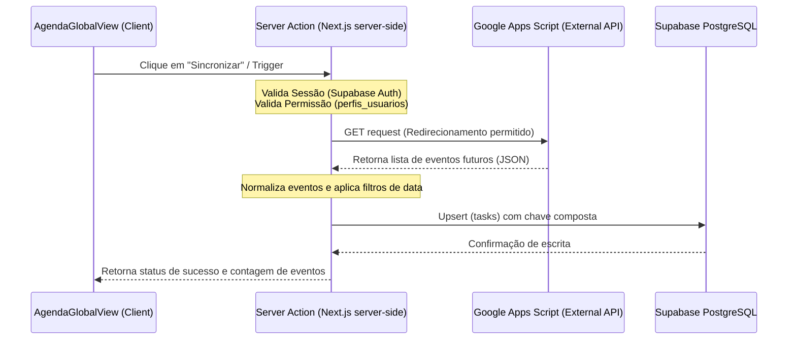

# Handover Técnico - Sincronização com o Google Calendar / Server Actions (`actions.ts`)

Este documento detalha o funcionamento, arquitetura e segurança da funcionalidade de sincronização da Agenda Global do Prisma com o Google Calendar, implementada através de Server Actions do Next.js.

---

## 1. Visão Geral e Contexto
O Prisma permite a importação direta de eventos oficiais de uma agenda externa do Google Calendar para a tabela central de `tasks` (com `tipo_agenda = 'GLOBAL'`). 

A integração é realizada através de um **Server Action** (`syncGoogleAgendaAction`) localizado na rota unificada `app/(portal)/agenda-global/actions.ts`. Este action consome uma API intermediária baseada em **Google Apps Script** e atualiza o banco de dados Supabase de forma atômica e segura.

---

## 2. Pilares da Arquitetura e Fluxo de Dados

A sincronização segue um fluxo unidirecional e seguro no backend:

### A. Integração com Google Apps Script
- O action realiza um request `fetch` para o endpoint configurado na variável de ambiente `GOOGLE_APPS_SCRIPT_URL`.
- O endpoint deve retornar um array de eventos no formato JSON contendo chaves como `id`, `titulo`, `local`, `descricao` e `data_hora_inicio`.
- O action filtra eventos do passado, importando **apenas eventos cuja data de início seja igual ou posterior ao momento atual**.

### B. Resolução de Conflitos e Chave Composta
- A tabela `tasks` no banco de dados possui uma restrição exclusiva de chave composta baseada nas colunas `google_event_id` e `unidade_id`.
- Isso garante que a importação seja **idempotente**: múltiplos disparos de sincronização não duplicam os eventos. O Supabase realiza um `upsert` com a instrução `onConflict: "google_event_id,unidade_id"` atualizando títulos, horários e descrições de eventos que sofreram alterações na origem.

### C. Uso Controlado da Chave de Service Role
- Como a operação de sincronização e upsert em massa pode ser executada por assessores que não possuem permissão direta de escrita irrestrita em todos os eventos do banco (via políticas RLS tradicionais), o Server Action utiliza o `supabaseAdmin` inicializado com a `SUPABASE_SERVICE_ROLE_KEY`.
- **Mitigação de Segurança:** O uso da chave de privilégio administrativo é blindado por verificações prévias e rigorosas de autenticação do usuário e consulta de seu respectivo cargo/permissão modular (ver seção abaixo).

---

## 3. Segurança e Regras de Negócio

Para preservar a segurança do sistema e evitar acessos indevidos com a Service Role Key, as seguintes regras são aplicadas:

1. **Autenticação via Cookies Seguros**:
   - O Server Action recupera os cookies de sessão ativos no Next.js usando o helper `cookies()` do `next/headers` e instancia o cliente SSR do Supabase.
   - A chamada `auth.getUser()` valida no backend do Supabase se a sessão é legítima e ativa.
2. **Validação de Permissão (RBAC)**:
   - Uma vez autenticado o usuário, o action consulta a tabela `public.perfis_usuarios` usando o ID do usuário para verificar as permissões modulares.
   - A sincronização é imediatamente interrompida com erro se o usuário não possuir a permissão `agenda_global_editar` em seu array de `modulos_acesso`.
3. **Retrocompatibilidade de Perfis (Legacy)**:
   - Para manter compatibilidade com consultas legadas que consomem a tabela `public.profiles` ao invés da tabela unificada `perfis_usuarios`, o Server Action realiza um upsert silencioso dos metadados do executor no momento do sync.

---

## 4. Variáveis de Ambiente Requeridas

Para o funcionamento completo da integração, as seguintes chaves devem estar configuradas no ambiente do servidor (`.env.local` / Produção):

| Variável | Descrição |
| :--- | :--- |
| `GOOGLE_APPS_SCRIPT_URL` | URL de publicação web do Google Apps Script integrado ao calendário corporativo. |
| `SUPABASE_SERVICE_ROLE_KEY` | Chave secreta de superusuário para operações administrativas no Supabase. |
| `NEXT_PUBLIC_SUPABASE_URL` | URL do projeto do Supabase. |
| `NEXT_PUBLIC_SUPABASE_ANON_KEY` | Chave pública anônima do Supabase. |

---

## 5. Próximos Passos e Manutenção
- **Webhook de Sincronização Automática**: Substituir o trigger manual de sincronização por webhooks periódicos disparados por um Cron Job ou gatilhos de alteração do Google Calendar.
- **Log de Telemetria**: Conectar erros de sincronização (ex: indisponibilidade da API do Apps Script) à tabela central `public.logs_sistema` criada na aba de Root.
