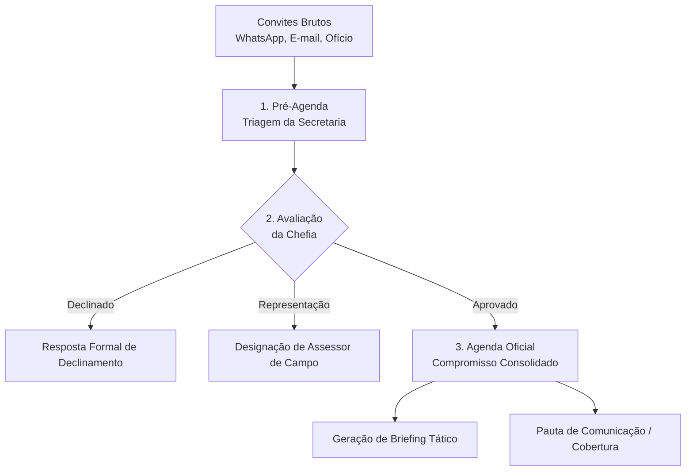
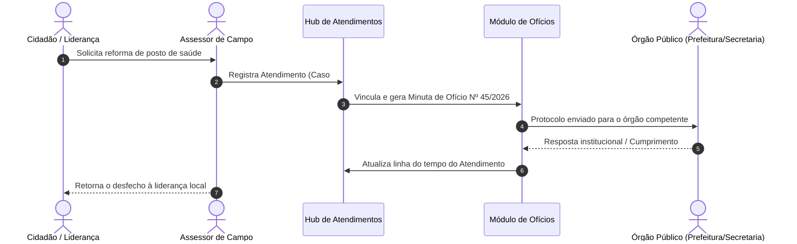
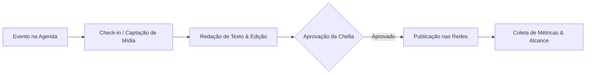
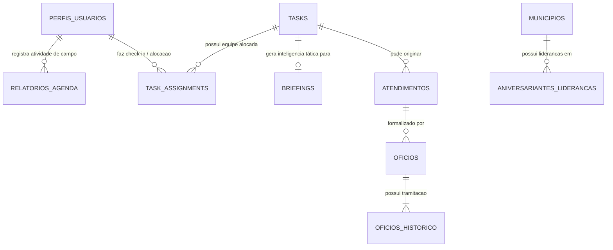

# Blueprint de Domínio & Workflow: Gestão de Gabinete Político

> **Documento de Especificação Conceitual de Domínio (DDD)**  
> **Objetivo:** Fornecer a um desenvolvedor a visão completa dos fluxos, papéis, regras de negócio e modelo mental de um sistema operacional para gabinete político.

---

## 1. Visão Geral: O que é um Gabinete Político?

Um gabinete político (parlamentar ou executivo — ex: Deputado, Senador, Vereador, Secretário) opera como uma **holding estratégica multissetorial**. Ele não pode ser modelado apenas como um CRM comercial ou um quadro Kanban genérico, pois lida simultaneamente com:

1. **Articulação Política e Base Eleitoral:** Relacionamento com prefeitos, vereadores, lideranças comunitárias e cidadãos.
2. **Administração e Trâmite Institucional:** Gestão da agenda oficial, protocolo de documentos oficiais (ofícios), emendas e prestação de contas.
3. **Comunicação Estratégica e Reputação:** Cobertura de eventos, produção de mídia, posicionamento e monitoramento de audiência.

```
                  ┌────────────────────────────────────────┐
                  │          O MANDATO / GABINETE          │
                  └───────────────────┬────────────────────┘
                                      │
        ┌─────────────────────────────┼────────────────────────────┐
        ▼                             ▼                            ▼
┌──────────────────┐        ┌──────────────────┐        ┌──────────────────┐
│   ARTICULAÇÃO    │        │  ADMINISTRAÇÃO   │        │   COMUNICAÇÃO    │
│    E POLÍTICA    │        │   INSTITUCIONAL  │        │   E REPUTAÇÃO    │
│ (Bases, Votos,   │        │ (Agenda Oficial, │        │ (Mídias Sociais, │
│  Atendimentos)   │        │ Ofícios, Verbas) │        │ Pautas, Imprensa)│
└──────────────────┘        └──────────────────┘        └──────────────────┘
```

### O Desafio Central de Arquitetura
- **Ambiente Caótico de Entrada:** Centenas de convites, pedidos de apoio e solicitações chegam semanalmente por WhatsApp, e-mail, ligações e encontros presenciais.
- **Dupla Realidade Geográfica:**
  - **Sede Central (CG):** Onde atuam a liderança política (Chefia), assessoria de imprensa e secretaria executiva.
  - **Bases Regionais / Campo (DD):** Assessores em constante deslocamento pelos municípios e bairros, colhendo demandas e representando o titular.
- **Sensibilidade de Dados e Reputação:** Informações estratégicas, posicionamentos e históricos de atrito político exigem controle de acesso rigoroso.

---

## 2. Atores e Papéis do Sistema (RBAC)

| Perfil / Cargo | Responsabilidade Real | Requisitos no Sistema |
| :--- | :--- | :--- |
| **Chefia de Gabinete** *(Decisão & Auditoria)* | Braço direito do político. Define prioridades estratégicas, autoriza representações e audita despesas/equipe. | Dashboards executivos, alertas de prazos, controle financeiro de campo e histórico de movimentações. |
| **Secretaria Executiva** *(Gestão de Rotina)* | Centraliza e tria convites, organiza horários, viagens e logística. | Cockpit de triagem (Pré-agenda), envio de confirmações e fechamento da Agenda Oficial. |
| **Assessoria de Campo** *(Articulação & Rua)* | Visita cidades/bairros, reúne-se com lideranças comunitárias e fiscaliza demandas locais. | Interface mobile-friendly para registro rápido de atendimentos, check-in em eventos e envio de comprovantes de despesas. |
| **Comunicação / Mídia** *(Narrativa & Reputação)* | Cobre eventos, produz conteúdo (fotos/vídeos), redige notas e monitora redes. | Calendário editorial de postagens, pautas vinculadas à agenda oficial e monitoramento de alcance. |
| **O Titular / Político** *(Consumidor do Briefing)* | A figura pública do mandato. Precisa dominar o contexto de cada reunião em poucos minutos. | Relatórios executivos mastigados (*Briefings* com histórico de votos, aliados locais e temas proibidos). |

---

## 3. Workflows Operacionais Core

### 🔄 Fluxo 1: O Funil da Agenda Oficial
Na política, **a agenda é poder**. O fluxo de validação de compromissos segue um funil determinístico:



1. **Pré-Agenda (Caixa de Entrada):** Eventos propostos com data, local, solicitante e tema inicial.
2. **Cockpit de Fechamento:** A chefia avalia relevância política, viabilidade logística e define se o titular vai pessoalmente ou se um assessor fará a representação.
3. **Agenda Oficial:** Roteiro consolidado do dia/semana com horários confirmados e equipe alocada.

---

### 📋 Fluxo 2: O Briefing Tático (Inteligência Pré-Evento)
Antes de entrar em qualquer reunião, palanque ou entrevista, o político necessita de um dossiê enxuto:

- **Contexto Local:** Quem é o anfitrião? É aliado, neutro ou oposição? Qual o histórico de emendas e parcerias com o município?
- **Mesa de Honra / Autoridades:** Lista de presentes confirmados com seus respectivos cargos e posicionamentos.
- **Blocos Estratégicos & Sigilosos:**
  - *Destaques/Entregas:* O que o mandato já fez por aquela entidade ou cidade.
  - *Temas Sensíveis / Proibidos:* Assuntos locais conflitantes que não devem ser abordados.
- **Formato de Saída:** Visualização limpa para consulta rápida no celular ou exportação em PDF padronizado para leitura durante o deslocamento.

---

### 🏛️ Fluxo 3: Hub de Atendimentos e Protocolo de Ofícios
O ciclo completo de uma demanda cidadã até a cobrança do poder público:



- **Atendimento (O Hub Central):** Registra a solicitação com solicitante, município, categoria e status (`Aberto`, `Em análise`, `Atendido`, `Arquivado`).
- **Ofício Institucional:** Instrumento formal assinado, numerado sequencialmente por ano (ex: `045/2026`).
- **Histórico & Rastreabilidade:** Registro imutável de todas as movimentações e respostas para que o caso não se perca.

---

### 📍 Fluxo 4: Articulação de Campo e Prestação de Contas
Para manter o alinhamento da equipe externa e evitar fraudes ou desvios:

- **Registro de Campo:** Assessores reportam visitas a obras, reuniões com lideranças e representações oficiais.
- **Comprovantes e Despesas:** Envio de fotos do local para comprovação de presença e cupons fiscais para prestação de contas de deslocamento/refeição.
- **Auditoria da Chefia:** Relatórios consolidados por assessor, região e categoria, com sinalização de desvios orçamentários.

---

### 📱 Fluxo 5: Esteira de Comunicação e Métricas
Conecta as entregas do mandato à sua divulgação pública:



1. **Pauta:** Nasce diretamente de um evento da agenda ou de um posicionamento temático.
2. **Captação:** O profissional de comunicação registra presença no evento e coleta depoimentos.
3. **Esteira de Produção:** Gestão de status da peça (`Pendente`, `Em Produção`, `Aprovado`, `Publicado`).
4. **Métricas de Engajamento:** Integração para monitoramento de visualizações, comentários e repercussão pública.

---

## 4. Modelo Conceitual de Dados (Entidades Principais)



### Descrição das Entidades Centrais:
- **`TASKS` (Agenda / Pautas):** Núcleo unificado de compromissos oficiais e pautas de comunicação.
- **`BRIEFINGS`:** Dossiês estratégicos vinculados a eventos oficiais.
- **`ATENDIMENTOS`:** Casos e demandas trazidas por cidadãos e lideranças.
- **`OFICIOS` & `OFICIOS_HISTORICO`:** Protocolo eletrônico e trilha de auditoria dos documentos expedidos.
- **`RELATORIOS_AGENDA`:** Registros de atividades de campo e prestação de contas dos assessores.
- **`ANIVERSARIANTES_LIDERANCAS`:** CRM político georreferenciado por município para manutenção contínua das bases.

---

## 5. Requisitos Não-Funcionais Críticos

1. **Isolamento Multi-Unidade (Multi-Tenancy):**
   - Escritórios diferentes (ex: Gabinete Central vs. Escritório Regional) devem operar com isolamento estrito de dados no nível de banco (RLS), impedindo vazamento de estratégias locais.
2. **Resiliência a Baixa Conectividade (Offline-First):**
   - Assessores em cidades do interior e estradas precisam conseguir registrar demandas mesmo com instabilidade de sinal 3G/4G.
3. **Zero Fricção de Interface (UX Simples):**
   - O perfil dos usuários varia de jovens criadores de conteúdo a lideranças tradicionais com baixa proficiência técnica. A interface deve ser direta, com poucos cliques e tipografia legível.
4. **Auditoria e Logs Imutáveis:**
   - Exclusões de compromissos, alterações em ofícios e movimentações de status precisam de logs detalhados com carimbo de data/hora e autor.

---

## 6. Glossário de Domínio Político

- **Titular:** O parlamentar ou secretário detentor do mandato.
- **Chefia de Gabinete:** Cargo executivo mais alto da equipe; coordena e aprova tudo.
- **Base Eleitoral:** Região geográfica ou grupo social onde o político tem maior densidade de votos.
- **Liderança:** Presidente de associação de bairro, vereador, líder religioso ou comunitário com poder de influência.
- **Ofício:** Documento formal que o mandato envia a prefeituras, secretarias ou ministérios solicitando providências ou prestando informações.
- **Emenda Parlamentar:** Recurso financeiro do orçamento público que o parlamentar destina a um município ou projeto específico.
- **Briefing:** Resumo tático e executivo preparado para orientar o político antes de um encontro.
